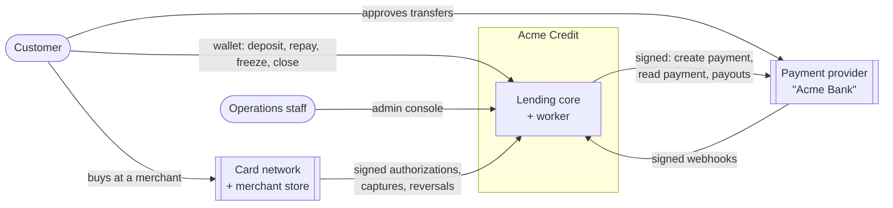
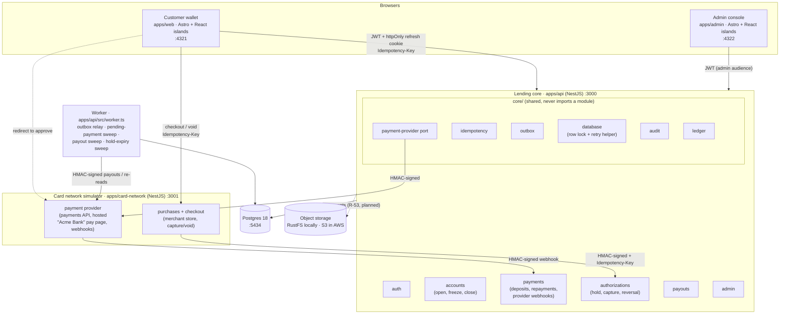
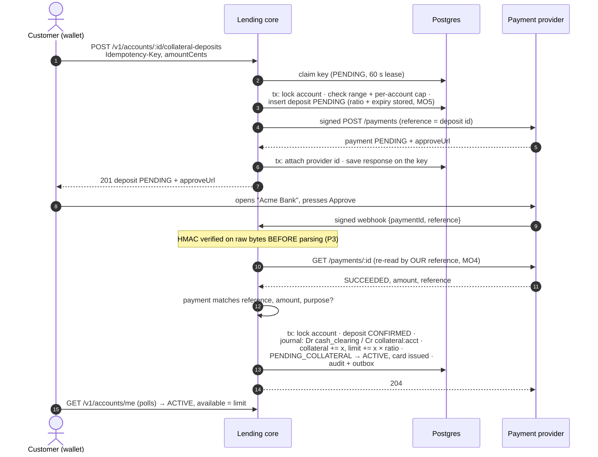
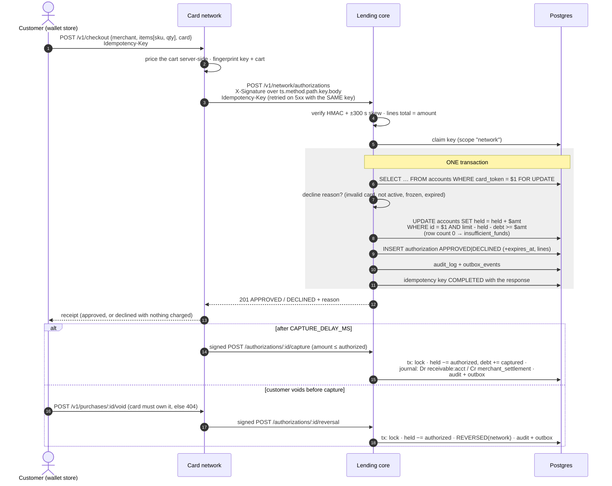
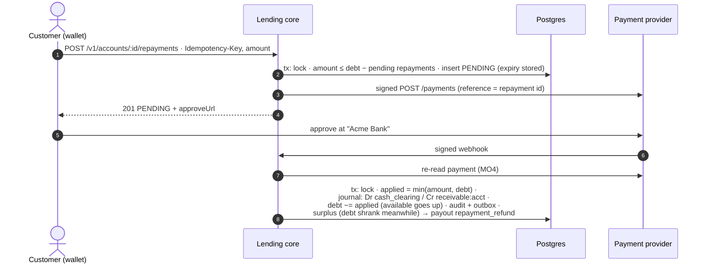
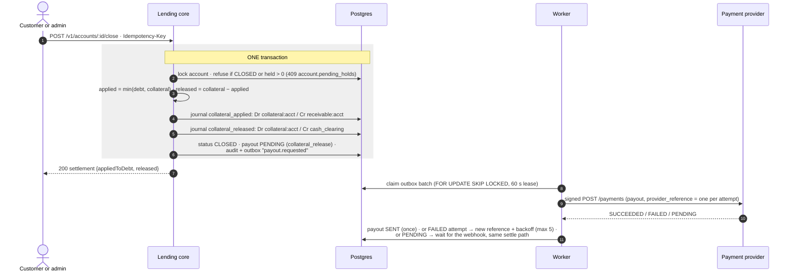
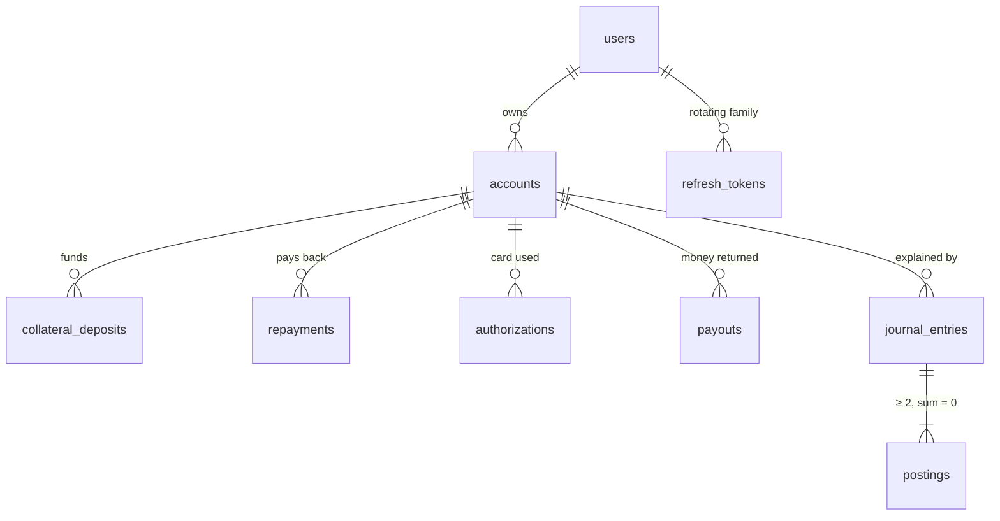

# Architecture

This is the system as built. Why it has this shape is covered in
[`thinking-process.md`](thinking-process.md) and in the ADRs ([`adr/`](adr/)). Deployment to
AWS is covered in [`deploy.md`](deploy.md).

> Requirements: R-07 (architecture), R-08a–f (critical-service concerns), R-09 (local
> infrastructure). Rules cited as `MO2`, `P3`, … are in [`CLAUDE.md`](../CLAUDE.md).

## 1. Context

Acme Credit owns the lending flow of a secured card. The customer funds a guarantee from their
bank, spends against it at merchants through a card network, pays back from their bank, and
gets the guarantee back (minus any unpaid debt) when the account closes. Two of those parties
are outside our trust boundary, and they are simulated here as real, separate processes: the
**card network** (with its merchants) and the **payment provider** (the customer's bank).

## 2. Containers

The lending core is a **modular monolith**: one deployable, one Postgres database, one ACID
transaction per money operation (ADR-0001). The things that really are separate systems in
real life (the network, the bank) and the slow side effects (payouts, sweeps) run as their
own processes.

| Container | Code | Responsibility |
| --- | --- | --- |
| Lending core | `apps/api/src/main.ts` | Every money decision. Modules under `src/modules/<domain>`; cross-cutting code under `src/core` (AN1). |
| Worker | `apps/api/src/worker.ts` | Same codebase, second entrypoint, no HTTP. Relays the outbox (`FOR UPDATE SKIP LOCKED`) and runs three sweeps: pending payments (30 s), payouts (30 s), expired holds (60 s). |
| Card network | `apps/card-network` | Merchant store pricing (`POST /v1/checkout`), plain purchases, delayed capture, void. Signs every call to the core and retries 5xx with the SAME key. |
| Payment provider | `apps/card-network/src/modules/provider` | Simulated bank: payments API (signed by the core), the hosted approve/decline page, signed webhooks retried until the core accepts them, payouts. |
| Customer wallet | `apps/web` | Sign-up/in, deposit, store, checkout, activity and order detail, repay, card page (freeze), profile (close). |
| Admin console | `apps/admin` | Own login (admin audience), dashboard, accounts (freeze/unfreeze/close, payouts), purchases (release a hold), ledger explorer, audit log. |
| Postgres | `infra/docker-compose.yml` | The single source of truth: accounts, journal, idempotency keys, audit log, outbox. |
| Object storage | RustFS (ADR-0005) | Documents (statements, R-53). Reached only through the S3 SDK, so AWS is a config change. |

Shared packages: `packages/contracts` (zod schemas, the error catalog, money parsing and
formatting used by every app), `packages/nest-core` (error envelope, default-deny guard,
request id, logging, bootstrap, HMAC signing), `packages/ui` (HeroUI v3 wrappers and brand
tokens for both web apps).

## 3. Request flows

Every money write below runs through `runInTransaction` (`core/database/transaction.ts`):
`SET LOCAL lock_timeout = '3s'`, then the work, retried up to 3 times on `40001`/`40P01`;
giving up or a lock timeout is `409 operation.in_progress`. Its first data statement is
`SELECT … FROM accounts WHERE id = $1 FOR UPDATE` (`core/database/account-lock.ts`).
`recordChange` (`core/audit/record-change.ts`) writes the audit row AND the outbox event in
that same transaction.

### 3.1 Deposit → provider webhook → activation (R-01, R-02)

- The webhook body only says "look again". A forged signature is 401, an unknown reference
  404, and a payment whose amount or reference is not ours is refused (MO4 attacker case).
- Provider down while re-reading → 503, nothing changes. The provider retries the webhook,
  and the worker's pending-payment sweep re-reads every PENDING payment and settles it through
  the same `PaymentSettlementService.settle`.
- A deposit the provider still has not paid after `PENDING_PAYMENT_TTL_MINUTES` becomes
  `EXPIRED` (only after the provider confirms it is unpaid). A late approval is still credited,
  or refunded through a payout if it no longer fits under the cap or the account closed.
- A second confirmed deposit on an ACTIVE account raises the limit (R-55).

### 3.2 Purchase authorization → capture / void (R-03)

- A hold is a reservation, not money that moved: it lives in the cached `held_cents` column
  under the same lock and the DB CHECK `held + posted_debt <= credit_limit`. The journal is
  written when money moves (capture).
- A hold nobody captures expires after `HOLD_TTL_HOURS` (168 h, stored at approval). The
  hold-expiry sweep releases it through the same reversal path; an admin can release one by
  hand. A capture after release is `409`.

### 3.3 Repayment (R-04)

Available credit returns only after the provider confirms; it never goes above the debt.

### 3.4 Close: release or apply collateral, then pay out (R-05)

Debt the collateral cannot cover stays recorded on the closed account (the receivable is not
written off silently).

## 4. Data model

The full diagram (every column, key and type) and the table of database-level guarantees
and indexes are in [database.md](database.md).

| Table | What it holds | Guarantees in the database |
| --- | --- | --- |
| `accounts` | Status (`PENDING_COLLATERAL → ACTIVE ⇄ FROZEN → CLOSED`), cached balances in `BIGINT` cents (`collateral`, `credit_limit`, `held`, `posted_debt`), card token and last 4, freeze origin (`frozen_by`, reason). | Every balance ≥ 0; `held + posted_debt <= credit_limit` while not CLOSED; at most one non-CLOSED account per customer (partial unique); freeze columns set exactly while FROZEN. |
| `collateral_deposits`, `repayments` | One row per bank transfer we asked for: amount, status (`PENDING/CONFIRMED/FAILED/EXPIRED`), the limit ratio and the expiry recorded at request time (MO5), provider id. | `amount > 0`; `0 < ratio ≤ 10000 bps`; `0 ≤ applied ≤ amount`. |
| `authorizations` | Every decision, declines included: amount, captured, status, decline/reversal reason, merchant, order lines (JSON), hold expiry. | `amount > 0`; `captured ≤ amount`; a decline reason exactly when DECLINED; expiry exactly when not DECLINED. |
| `payouts` | Money we send back (collateral release, repayment refund, late-deposit refund), attempt count, one provider reference per attempt, backoff. | `amount > 0`; unique provider reference. |
| `journal_entries`, `postings` | Double-entry journal. Chart: `collateral:<acct>` (liability), `receivable:<acct>` (asset), `cash_clearing`, `merchant_settlement`. Debits positive, credits negative. | A **DEFERRABLE INITIALLY DEFERRED constraint trigger** rejects at commit any entry with fewer than two postings or a non-zero sum; UPDATE and DELETE are rejected (append-only). |
| `idempotency_keys` | `(scope, key)` unique; SHA-256 of route + canonical body; status; stored response; lease (`locked_until`, `attempt`). | The response is written in the same transaction as the effect (ADR-0004). |
| `audit_log` | Actor (customer/admin/network/provider/system), action, entity, request id, data (ids, enums, amounts as strings; no personal data). | Written in the same transaction as the change. |
| `outbox_events` | Event type = audit action, payload, attempts, `available_at`, `processed_at`, last error. | Exists if and only if its change committed (P2). |

Migrations are hand-reviewed SQL in `apps/api/prisma/migrations`; the CHECKs, the partial
unique index and the triggers live there, and a drift test proves the migrations build exactly
`schema.prisma`.

## 5. Critical-service guarantees

Spec names are the `it(...)` titles in `apps/api/test/integration/*.int-spec.ts` (core) and
`apps/card-network/test/integration/*.int-spec.ts` (network). They run against a real Postgres
(`pnpm test:integration`).

| Concern | Mechanism | Proved by |
| --- | --- | --- |
| **Concurrency** (R-08a) | Account row lock as the first statement of every money transaction; the hold itself is a conditional update with its row count checked; DB CHECK as the last line; one lock order (account → collateral → idempotency); `lock_timeout = 3s`; one retry helper for `40001`/`40P01`. Sweeps lock with `SKIP LOCKED`. | `authorizations.int-spec.ts` "approves exactly as many of 50 parallel purchases as fit, never over the limit (ADR-0003)"; `holds.int-spec.ts` "capture ∥ release on the same hold: exactly one wins, every time (concurrency)"; `domain-hardening.int-spec.ts` "N parallel deposits: only what fits under the cap passes (concurrency)"; `payouts.int-spec.ts` "N parallel senders of one payout: one provider payment, SENT once (concurrency)"; `platform.int-spec.ts` "keeps balances non-negative and within the limit (CHECKs)". |
| **Idempotency** (R-08d) | Client-generated `Idempotency-Key` required on every money POST (wallet keeps it in session storage for 24 h; card-network derives it from the request). Key + request hash + response committed with the effect. Same key + other body → `409 idempotency.key_reused`; live claim → `409 idempotency.in_progress`; a crashed claim is taken over after its 60 s lease by exactly one retry. The key is inside the HMAC, so a captured request cannot be replayed under a new key. | `authorizations.int-spec.ts` "answers a network retry with the same decision and a single hold; another payload is 409"; `domain-hardening.int-spec.ts` "lets a retry take over a crashed request once its lease lapsed, running the effect once", "answers 409 in_progress while the lease is live, and runs nothing", "two retries racing for a lapsed key: one takes it over, one effect"; `signatures.int-spec.ts` "network → core: other key 401, 301 s late 401, same key replays; one hold"; card-network `checkout.int-spec.ts` "binds the key to the quantities: the same SKU, 1 then 2 → 409 key_reused, one core call". |
| **Consistency** (R-08c) | One ACID transaction per operation in one database (no sagas on the money path). Balanced journal enforced twice (domain `assertBalanced` + deferred DB trigger). Audit and outbox written inside the transaction; side effects (provider calls, payouts) only after commit, via the outbox. | `platform.int-spec.ts` "rejects at commit an entry whose postings do not sum to zero", "accepts a balanced entry, and an entry with a single posting is rejected", "keeps the journal append-only", "replaying every migration yields exactly schema.prisma (drift test)", "re-delivers an event once when the worker crashed between claim and done"; `admin.int-spec.ts` "shows the dashboard with a zero trial balance". |
| **Auditability** (R-08e) | Every state change writes an `audit_log` row (actor, action, entity, request id) in its transaction; balances are explained by the append-only journal; the admin console reads both directly. Request id in every log line, response header and error envelope. | `admin.int-spec.ts` "finds an account by the customer email and shows it with its purchases, ledger and audit", "freezes, unfreezes and closes any account, audited as the admin"; `pagination.int-spec.ts` "ledger, global and of one account, and the audit log, global and of one entity"; `health.int-spec.ts` "answers an unknown route with the envelope sharing the header id". |
| **Money handling** (R-08f) | Integer cents end to end: `BIGINT` in Postgres, `bigint` in code, strings of digits in JSON. One parser for typed input (`parseMoneyInput` in `packages/contracts`) rejects a third decimal, signs and exponents. Limits fixed at request time (MO5). Credit only after re-reading the provider (MO4). Boundary pairs on every rule. | `authorizations.int-spec.ts` "declines one cent over the available credit and approves exactly the available amount", "accepts lines totalling the amount and refuses one cent more or less before writing anything"; `lending.int-spec.ts` "accepts USD 200.00 and USD 10,000.00 and refuses one cent outside (boundary pairs)", "uses the ratio stored with the deposit, not the policy at confirmation (MO5)", "never credits a provider payment whose amount is not ours (MO4 attacker case)"; `settlement.int-spec.ts` "restores available credit only after the provider confirms, never above the debt", "applies the collateral to the debt first and releases the rest"; unit `money.spec.ts` (contracts, api). |
| **Security** (R-08b) | Default-deny guard: every route declares exactly one access marker (checked by a test). Customer JWT + httpOnly `SameSite=Strict` refresh cookie with rotation and family revocation; admin is a separate audience. Ownership in the query (foreign → 404). HMAC-SHA256 on service calls, verified on raw bytes before parsing, ±300 s skew. Admin answers show last 4 only. Rate limits, strict DTOs, CSP and security headers; no secrets or demo passwords in code or bundles. | `health.int-spec.ts` "declares exactly one access marker on every route (AN10)"; `auth.int-spec.ts` "rotates the refresh token; replaying a rotated one revokes the whole family", "logs the seeded admin into the admin app only (role must match the audience)"; `lending.int-spec.ts` "answers 404 for another customer's account, on read and on write", "refuses a forged webhook (401) and an unknown reference (404), changing nothing"; `authorizations.int-spec.ts` "refuses an unsigned or forged call and a missing key"; `domain-hardening.int-spec.ts` "admin freezes with a reason; the customer unfreeze is 409; the admin unfreezes"; `admin.int-spec.ts` "detail, list, freeze (and its replay), unfreeze and close answer exact keys"; card-network `purchases.int-spec.ts` "answers 404 to another card that learned the id (attacker), leaving the hold to be captured". |

End to end, `e2e/specs/customer-golden-path.spec.ts` (sign up → deposit approved at the bank →
buy → over-limit decline → repay → close) and `admin-golden-path.spec.ts` run at 1280 px and
360 px against the Docker stack.

## 6. Failure modes

| Failure | What happens | Proved by |
| --- | --- | --- |
| **Provider down** while creating a deposit/repayment | The request answers `503 payment.provider_unavailable`; the row and the idempotency key stay, so the client's retry with the same key resumes the same deposit instead of creating a second one. | `lending.int-spec.ts` "resumes the same deposit when the client retries after a provider outage" |
| **Provider down** while re-reading for a webhook | `503`, nothing credited. The provider retries the webhook; the pending-payment sweep re-reads and settles late approvals through the same path. A timeout is "unknown", never "failed". | `lending.int-spec.ts` "answers 503 and changes nothing while the provider is down, then settles (MO4)"; `worker.int-spec.ts` "sweeps a payment approved without a webhook through the same settlement path (MO4)" |
| **Provider down** while paying out | The payout stays PENDING with a note; the next sweep sends the same reference once. A FAILED attempt gets a new reference with backoff, up to 5 attempts. | `payouts.int-spec.ts` "provider down: nothing changes but the note; later the same reference is sent once (provider-down)", "retries a FAILED attempt with a new reference and backoff; after the last one it is FAILED, once" |
| **Network retry** (timeout, 5xx, duplicate) | card-network retries with the SAME key; the core replays the stored decision, one hold. If the core stays down the shopper gets `503` and the same key works later. | `authorizations.int-spec.ts` "answers a network retry with the same decision and a single hold; another payload is 409"; `purchases.int-spec.ts` "retries 5xx with the SAME key until the core answers", "answers 503 payment.provider_unavailable when the core stays down; the same key works later" |
| **Crash between claim and done** (outbox) | The claim is a 60 s lease; a crashed worker's events become visible again and are handled once more. Handlers are idempotent (payout by its own row and reference). Failing events back off (2 s … 5 min, 8 attempts) with the last error kept. | `platform.int-spec.ts` "re-delivers an event once when the worker crashed between claim and done", "reschedules a failing event with its last error"; `worker.int-spec.ts` "sends a requested payout through the provider and marks it SENT, once" |
| **Crash between claim and done** (API request) | The idempotency key's lease lapses after 60 s; one retry takes it over (`attempt + 1`); a stale attempt that wakes up cannot complete the key, so its effect rolls back. | `domain-hardening.int-spec.ts` "lets a retry take over a crashed request once its lease lapsed, running the effect once" |
| **Double click / reload** in the wallet | The key is generated once per intent and kept in session storage until the server gives a definitive answer; a second submit replays the first response, a concurrent one gets `409 idempotency.in_progress` and the UI keeps the key to retry. | `apps/web/src/app/lib/__tests__/idempotency.spec.ts`; `lending.int-spec.ts` "requires an Idempotency-Key, a session and the customer role" |
| **Merchant never captures** | The hold expires after 168 h and is released by the sweep (or by an admin); a late capture is `409`. | `holds.int-spec.ts` "releases an expired hold through the reversal path; a capture afterwards is 409", "refuses the capture of an expired hold even before the sweep reaches it" |
| **Customer never approves at the bank** | The payment expires after 30 min only once the provider confirms it unpaid; it stops blocking new requests; a late approval still settles. | `domain-hardening.int-spec.ts` "unblocks after expiry, expires only what the provider confirms unpaid, settles a late approval" |
| **Lock contention** | `lock_timeout` 3 s → `409 operation.in_progress`, retryable with the same key. | unit `database.spec.ts` |
