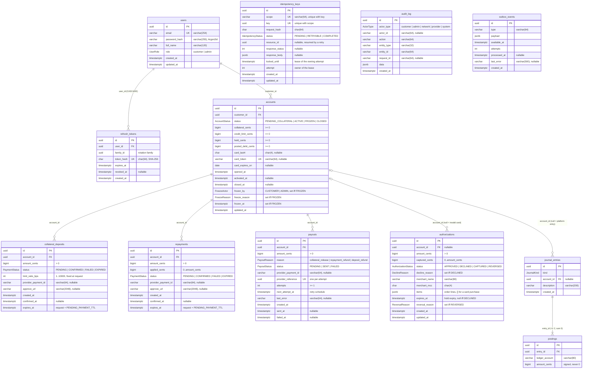

# Database — lending core

The lending core (`apps/api`) owns the only database: PostgreSQL, schema in
[`apps/api/prisma/schema.prisma`](../apps/api/prisma/schema.prisma), built by the hand-reviewed
migrations in [`apps/api/prisma/migrations/`](../apps/api/prisma/migrations/) (never
`migrate dev`, AN8). The card network keeps no database of its own.

Conventions: ids are UUID v7 (`uuid(7)`, time-ordered); money is `BIGINT` integer cents (P1,
ADR-0002); instants are `timestamptz(3)` (UTC); business dates are `date`. Every foreign key
is `ON DELETE RESTRICT` except `refresh_tokens.user_id` (`CASCADE`).

A rendered copy of the diagram is in [`database.svg`](database.svg).

## Entity–relationship diagram

`idempotency_keys`, `audit_log` and `outbox_events` carry no foreign key on purpose: they
reference resources by id across tables (`audit_log.entity_id`, `idempotency_keys.resource_id`)
and must outlive or precede the rows they describe.

## Guarantees enforced by the database

What Prisma cannot express lives in the hand-written part of each migration and is documented
with `///` on its model. The application checks these rules first; the database is the last
line of defence when two requests race or a bug slips through.

| Guarantee | Object | Kind | Migration |
| --- | --- | --- | --- |
| Account balances never negative (`collateral`, `credit_limit`, `held`, `posted_debt` ≥ 0) | `accounts_balances_non_negative` | CHECK | `20261021191651_lending_core` |
| While not CLOSED, `held + posted_debt ≤ credit_limit` (behind the row lock, ADR-0003) | `accounts_within_limit` | CHECK | `20261021191651_lending_core` |
| At most one non-CLOSED account per customer | `accounts_one_open_per_customer` on `(customer_id) WHERE status <> 'CLOSED'` | Partial unique index | `20261021191651_lending_core` |
| `frozen_by`, `freeze_reason`, `frozen_at` set exactly while FROZEN | `accounts_frozen_by` | CHECK | `20261022191708_domain_hardening` |
| Deposit amount > 0; limit ratio in `(0, 10000]` bps | `collateral_deposits_amount_positive`, `collateral_deposits_ratio_range` | CHECK | `20261021191651_lending_core` |
| Repayment amount > 0; `0 ≤ applied ≤ amount` | `repayments_amount_positive`, `repayments_applied_range` | CHECK | `20261021191651_lending_core` |
| Payout amount > 0 | `payouts_amount_positive` | CHECK | `20261021191651_lending_core` |
| Payout attempts ≥ 1; one provider reference per attempt | `payouts_attempts_positive`, `payouts_provider_reference_key` | CHECK, unique index | `20261022191708_domain_hardening` |
| Authorization amount > 0; `0 ≤ captured ≤ amount` | `authorizations_amount_positive`, `authorizations_captured_range` | CHECK | `20261021191651_lending_core` |
| A decline reason exactly when DECLINED | `authorizations_decline_reason` | CHECK | `20261021191651_lending_core` |
| A hold expiry exactly when not DECLINED; a reversal reason exactly when REVERSED | `authorizations_expiry`, `authorizations_reversal_reason` | CHECK | `20261022191708_domain_hardening` |
| A posting is never zero | `postings_amount_non_zero` | CHECK | `20261021191651_lending_core` |
| At commit, every journal entry has ≥ 2 postings summing to zero | `journal_entries_balanced`, `postings_balanced` → `assert_journal_entry_balanced()` | Constraint triggers, `DEFERRABLE INITIALLY DEFERRED` | `20261021191651_lending_core` |
| The ledger is append-only (UPDATE / DELETE rejected) | `journal_entries_append_only`, `postings_append_only` → `reject_ledger_rewrite()` | Triggers | `20261021191651_lending_core` |
| One idempotency record per `(scope, key)` | `idempotency_keys_scope_key_key` | Unique index | `20261021191651_lending_core` |
| One user per email; one session per token hash; one account per card token | `users_email_key`, `refresh_tokens_token_hash_key`, `accounts_card_token_key` | Unique indexes | `20261021191651_lending_core` |

### Indexes for keyset pagination and the worker

Every list is keyset-paginated newest first (`ORDER BY created_at DESC, id DESC`, cursor
`(created_at, id) < (…)`, migration `20261022015001_keyset_list_indexes`): each page starts at
the cursor and reads `limit + 1` rows, however deep.

| Table | Index | Serves |
| --- | --- | --- |
| `accounts` | `(status, opened_at DESC, id DESC)`, `(opened_at DESC, id DESC)`, `(customer_id, opened_at)` | Admin account list (filtered and not); the customer's account |
| `collateral_deposits` | `(account_id, created_at DESC, id DESC)`, `(status, created_at)` | Deposit history; the sweep of stale PENDING payments |
| `repayments` | `(account_id, created_at DESC, id DESC)`, `(status, created_at)` | Repayment history; the sweep of stale PENDING payments |
| `payouts` | `(account_id, created_at DESC, id DESC)`, `(created_at DESC, id DESC)`, `(status, created_at DESC, id DESC)`, `(status, next_attempt_at)` | Payout lists; the worker's due-retry scan |
| `authorizations` | `(account_id, created_at DESC, id DESC)`, `(created_at DESC, id DESC)`, `(status, created_at DESC, id DESC)`, `(status, expires_at)` | Purchase lists; the worker's hold-expiry sweep |
| `journal_entries` | `(account_id, created_at DESC, id DESC)`, `(created_at DESC, id DESC)` | Account ledger and global ledger |
| `postings` | `(entry_id)`, `(ledger_account)` | Postings of an entry; reconciliation per ledger account |
| `audit_log` | `(entity_id, created_at DESC, id DESC)`, `(created_at DESC, id DESC)` | Audit trail of one entity and the whole log |
| `outbox_events` | `(processed_at, available_at)` | The worker's claim (`FOR UPDATE SKIP LOCKED`) of due events |
| `refresh_tokens` | `(user_id)`, `(family_id)` | Revoking a user's sessions or a whole rotation family |
| `idempotency_keys` | `(created_at)` | Time-ordered scans of keys (no purge job exists yet) |
| `users` | `(full_name)` | Name lookups; note the admin search is `contains` (`ILIKE '%q%'`), which a btree index cannot serve |
