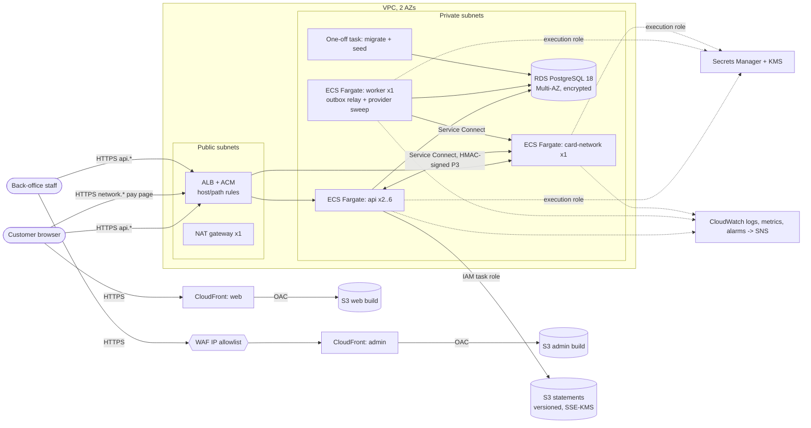

# Deploying to AWS (R-10)

The challenge does not require a real deployment. This document explains how acme-credit runs on
AWS, and `infra/terraform/` holds the Infrastructure as Code for it. The Terraform targets
Terraform ≥ 1.9 and the AWS provider `~> 6.0`.

The local stack (`infra/docker-compose.yml`) and AWS run the same images with the same commands
and the same environment variables. Only the infrastructure around them changes. Section 10
lists every difference.

## 1. Architecture



| Hostname | Served by | Notes |
|---|---|---|
| `app.<domain>` (web) | CloudFront → S3 | Static Astro build. Security headers come from a response-headers policy. |
| `admin.<domain>` (admin) | CloudFront → S3 (+ optional WAF) | A separate bucket and distribution: a separate attack surface (plan decision 8). |
| `api.<domain>` | ALB → `api` | `/v1/network/*` and `/v1/webhooks/*` return 404 on the public hostname. They are server-to-server only (P3). |
| `network.<domain>` | ALB → `card-network` | The pay page and checkout are public. `/v1/provider/*` is internal only. |

## 2. Why each piece (cost vs reliability)

| Piece | Choice | Why / trade-off |
|---|---|---|
| Compute | **ECS Fargate** | No nodes to patch, and per-task IAM roles and security groups. EKS would add about $73/month for the control plane and a lot of operational work, with no need for it at three services. Lambda does not fit a long-running outbox worker or Prisma connection pools. |
| Network | VPC in **2 AZs**, private subnets, **1 NAT** | Two AZs let the ALB, the API and RDS survive an AZ failure. One NAT saves about $33/month. The cost: if the NAT's AZ fails, tasks in the other AZ lose outbound internet until the AZ comes back. Running tasks keep serving, but new tasks cannot pull from ECR. Use one NAT per AZ, or VPC interface endpoints, once uptime is worth about $33/month more. S3 traffic already goes through a free gateway endpoint. |
| Ingress | **ALB** + ACM, TLS 1.3 policy | Host routing for two services, health checks, and the 5xx and latency metrics the alarms use. HTTP redirects to HTTPS, and unknown hosts get a 404. |
| Static sites | **S3 + CloudFront (OAC)** | Costs pennies, gives a global cache and needs no servers. The buckets stay private, readable only by their own distribution. A CloudFront Function copies nginx's `try_files $uri/index.html`. |
| Admin protection | Optional **WAF IP allowlist** | About $6/month. It hides the back office from the internet. Login and the `admin` role (A14) still protect the API either way. |
| Database | **RDS PostgreSQL 18**, Multi-AZ (variable) | The money path is one ACID transaction (ADR-0001, ADR-0003, ADR-0004), so the database is the component that must not fail. Multi-AZ doubles the DB cost and buys about 60–120 s failover with RPO 0. Aurora costs more at this size and is not needed yet. |
| Documents | **S3** (versioned, SSE-KMS, TLS-only, public access blocked) | ADR-0005: the code already speaks S3. Versioning makes an overwritten or deleted statement recoverable. |
| Secrets | **Secrets Manager + one CMK** | ECS injects the secrets at task start (`secrets`), so they never appear in the task definition or the image. Each workload's execution role can read only its own secrets. |
| Images | **ECR**, immutable tags, scan on push, keep 30 | Immutable tags make a git SHA mean one image. The last 30 images are the rollback window. |
| Observability | CloudWatch Logs + Container Insights + alarms → SNS | Built in and cheap at this volume. Section 9 lists what to add later. |

### Rough monthly cost (us-east-1, on-demand, low traffic)

| Item | ≈ USD/month |
|---|---|
| Fargate: api 2 × (0.5 vCPU, 1 GB) + worker + card-network (0.25 vCPU, 0.5 GB each) | 54 |
| RDS db.t4g.small Multi-AZ + 2 × 20 GB gp3 | 51 |
| NAT gateway (1) + light data | 35 |
| ALB (+ LCUs) | 22 |
| Public IPv4 (ALB × 2, NAT × 1) | 11 |
| CloudWatch (logs, Container Insights, 8 alarms) | 12 |
| WAF (admin) | 6 |
| Secrets Manager (6), KMS (1), ECR, S3, CloudFront | 8 |
| **Total** | **≈ 200** |

A lean demo variant costs about $140/month: single-AZ RDS, 1 API task and no WAF. Graviton
(`cpu_architecture = "ARM64"`) cuts the Fargate line by about 20%. Fargate Spot is already
registered on the cluster, but the core does not use it: money paths should not be interrupted.

## 3. Prerequisites

1. An AWS account, and an IAM role for Terraform. For CI, this is the GitHub OIDC role from
   section 5.
2. A domain, plus two ACM certificates: one in the deployment region for
   `api.` and `network.`, and one in **us-east-1** for `app.` and `admin.` (CloudFront requires
   us-east-1). Validate both by DNS.
3. A remote state bucket and lock table. Uncomment the `backend "s3"` block in
   `infra/terraform/versions.tf`. The state holds the generated DB password and app secrets, so
   the bucket must be private, versioned and KMS-encrypted.
4. **The RDS CA in the image.** `pg` 8 treats `sslmode=require` as `verify-full`, and Node's
   trust store does not include the Amazon RDS CA. The ECS task definitions set
   `NODE_EXTRA_CA_CERTS=/app/certs/rds-global-bundle.pem`. The runtime stage of
   `infra/docker/node-service.Dockerfile` must ship that file. The change is:
   ```dockerfile
   ADD --chown=node:node https://truststore.pki.rds.amazonaws.com/global/global-bundle.pem /app/certs/rds-global-bundle.pem
   ```
   Until that change ships, set `db_ssl_mode = "no-verify"`. The connection is still encrypted,
   but the server certificate is not verified.

## 4. Step-by-step deploy

Commands run in sh (Git Bash or WSL on Windows). `TAG` is the git SHA.

```sh
cd infra/terraform
cp terraform.tfvars.example terraform.tfvars        # fill domains, cert ARNs, CIDRs, image_tag
terraform init
# First time only: create the ECR repositories so there is somewhere to push.
terraform apply -target=aws_ecr_repository.this
```

**1. Build and push the service images** (one image serves api, worker and migrate):

```sh
TAG=$(git rev-parse --short HEAD)
REGION=us-east-1
REGISTRY=$(terraform output -json ecr_repositories | jq -r '.api' | cut -d/ -f1)
aws ecr get-login-password --region $REGION | docker login --username AWS --password-stdin $REGISTRY

cd ../..   # repo root (the Dockerfiles build from the monorepo root)
docker buildx build --platform linux/amd64 --push \
  -f infra/docker/node-service.Dockerfile --build-arg PACKAGE=@acme/api \
  -t $REGISTRY/acme-credit/api:$TAG .
docker buildx build --platform linux/amd64 --push \
  -f infra/docker/node-service.Dockerfile --build-arg PACKAGE=@acme/card-network \
  -t $REGISTRY/acme-credit/card-network:$TAG .
```

Use `--platform linux/arm64` together with `cpu_architecture = "ARM64"`.

**2. Apply the infrastructure** with the new tag. This registers new task definitions:

```sh
cd infra/terraform
terraform apply -var image_tag=$TAG
```

On the first apply the services start before any migration has run. The API's `/ready` check
fails until step 3 completes, and the deployment circuit breaker keeps retrying. On later
deploys, run step 3 between "register task definitions" and "update services". The CI pipeline
(section 5) does this.

**3. Run the migration task** (`prisma migrate deploy`, then the idempotent seed) and wait for
exit code 0:

```sh
TASK=$(eval "$(terraform output -raw migrate_run_task_command)")
aws ecs wait tasks-stopped --cluster $(terraform output -raw ecs_cluster) --tasks $TASK
aws ecs describe-tasks --cluster $(terraform output -raw ecs_cluster) --tasks $TASK \
  --query 'tasks[0].containers[0].exitCode'          # must print 0
```

Migrations are additive (expand → backfill → contract, A11), so the old API version keeps
working against the new schema while the services roll.

**4. Build and upload the static sites.** `PUBLIC_*` values are baked in at build time.
`PUBLIC_DEMO_MODE` must be `false` and the demo credentials must be empty in production:

```sh
cd ../..
export PUBLIC_DEMO_MODE=false PUBLIC_DEMO_EMAIL= PUBLIC_DEMO_PASSWORD= \
       PUBLIC_DEMO_ADMIN_EMAIL= PUBLIC_DEMO_ADMIN_PASSWORD=
PUBLIC_API_URL=https://api.acme.example PUBLIC_NETWORK_URL=https://network.acme.example \
  SITE_URL=https://app.acme.example pnpm --filter @acme/web build
PUBLIC_API_URL=https://api.acme.example SITE_URL=https://admin.acme.example \
  pnpm --filter @acme/admin build

for APP in web admin; do
  BUCKET=$(terraform -chdir=infra/terraform output -json site_buckets | jq -r ".$APP")
  # WA5: hashed assets immutable, everything else (HTML) revalidated.
  aws s3 sync apps/$APP/dist/_astro s3://$BUCKET/_astro \
    --cache-control "public, max-age=31536000, immutable"
  aws s3 sync apps/$APP/dist s3://$BUCKET --delete --exclude "_astro/*" \
    --cache-control "no-cache"
done
```

**5. Invalidate CloudFront** so the new HTML is served right away (hashed assets need no
invalidation):

```sh
for APP in web admin; do
  DIST=$(terraform -chdir=infra/terraform output -json cloudfront_distribution_ids | jq -r ".$APP")
  aws cloudfront create-invalidation --distribution-id $DIST --paths "/*"
done
```

**6. Smoke test:** `curl -fsS https://api.acme.example/health`. Then sign in to admin from an
allowed IP, and run the deposit → purchase → repayment path once.

**Rollback.** Re-run `terraform apply -var image_tag=<previous SHA>`. ECS also rolls back on its
own when a new task never becomes healthy (deployment circuit breaker). For the static sites,
the buckets are versioned: re-upload the previous build and invalidate.

## 5. CI/CD sketch (GitHub Actions + OIDC)

`.github/workflows/ci.yml` already gates every push and PR: frozen-lockfile install,
`pnpm audit --prod`, format, lint, typecheck, unit and integration tests, and builds. Deployment
would be a second workflow, `deploy.yml`, on `push` to `main`. It runs only after `ci` succeeds
(`workflow_run`), using a protected `production` environment that needs a manual approval.

- **No static AWS keys.** `permissions: id-token: write`, then
  `aws-actions/configure-aws-credentials` (pinned by SHA) with `role-to-assume` set to a role
  whose trust policy accepts only
  `token.actions.githubusercontent.com:sub = repo:<org>/acme-credit:environment:production`.
  That role can push to the four ECR repos, run `terraform apply` against the state bucket,
  call `ecs:RunTask`/`ecs:DescribeTasks`, `s3:PutObject`/`s3:DeleteObject` on the two site
  buckets, and `cloudfront:CreateInvalidation`.
- **Jobs:**
  1. `images`: `docker/setup-buildx-action`, then `docker/build-push-action` for api and
     card-network tagged `${{ github.sha }}`, with the GitHub Actions cache (`cache-from: type=gha`).
  2. `infra`: `terraform plan -var image_tag=$SHA`, uploaded as an artifact, then `apply` of that
     plan. Task definitions change here.
  3. `migrate`: run the migration task (section 4, step 3). A non-zero exit fails the job, and
     the services are not updated.
  4. `rollout`: `aws ecs update-service --force-new-deployment` (or the apply itself), then
     `aws ecs wait services-stable`.
  5. `static`: build web and admin with the production `PUBLIC_*` values, sync to S3, and
     invalidate CloudFront.
  6. `smoke`: `curl /health` plus a minimal Playwright run against production.
- A schedule (weekly) runs `terraform plan -detailed-exitcode` to detect drift.

## 6. Secrets and rotation

- `secrets.tf` generates `JWT_SECRET`, `NETWORK_SIGNING_SECRET`, `PROVIDER_SIGNING_SECRET`,
  `PROVIDER_API_SECRET`, `SEED_ADMIN_PASSWORD` and the database credentials, all 40–48 random
  characters, on the first apply. After that, Secrets Manager owns them: `ignore_changes`
  stops Terraform from reverting a rotation. No secret appears in tfvars, outputs, images or
  task definitions. Both apps refuse to boot in production on a missing secret or a `dev-only-`
  default (A8).
- **Rotating an HMAC or JWT secret:** `aws secretsmanager put-secret-value`, then
  `aws ecs update-service --force-new-deployment` for every consumer. Restart api and worker
  first, then card-network: they share `*_SIGNING_SECRET`. While the rotation is in progress,
  calls signed with the old value fail with 401, and the P3 idempotency keys make the network's
  retries safe. A rotated `JWT_SECRET` signs everyone out when their access token expires
  (≤ 15 minutes). Refresh tokens are kept in the database and survive. Zero-downtime rotation
  would accept a `*_PREVIOUS` value for one TTL (a small code change, not done yet).
- **Database password:** change it with `aws rds modify-db-instance --master-user-password`,
  update the `password` and `DATABASE_URL` keys of `<name>/database`, then redeploy api and
  worker. A Secrets Manager rotation Lambda for this "single user" case can automate it. The
  alternative is RDS-managed master secrets with the URL built at boot, which needs a small
  change in the app's config.
- The CMK has yearly automatic key rotation. Hardening for later: Terraform ≥ 1.11 write-only
  arguments (`password_wo`) keep the DB password out of the state.

## 7. Scaling

- **api:** stateless (JWT access tokens, refresh tokens in Postgres), so it scales
  horizontally. A target-tracking policy keeps average CPU at 60% between
  `api_desired_count` (2, one per AZ) and `api_max_count` (6).
- **worker:** one task. The relay claims outbox rows with `FOR UPDATE SKIP LOCKED` (P2), so more
  workers would be safe. Add them when the outbox lag grows, not before.
- **card-network:** a simulator with one task. In production it is replaced by real third
  parties (section 10).
- **Database:** move up instance classes first (vertical), then add a read replica for admin
  reports and `bench-reads`-style queries. Connections: each API task holds a Prisma pool, so
  the sum must stay under `max_connections`. Add RDS Proxy when task counts grow.
- **Why the core is not split into microservices:** the money path is one database transaction.
  Checking available credit, placing the hold and posting the ledger entry must commit together
  under a row lock (ADR-0001, ADR-0003). Splitting collateral, cards and ledger into separate
  services would turn "never over the limit" into a saga with compensations. So the core stays
  a modular monolith that scales out as identical stateless replicas over one Postgres, and
  only the parts that are really outside the trust boundary (the network and the provider) are
  separate services.

## 8. Backups and disaster recovery

| Scenario | Mechanism | RPO | RTO |
|---|---|---|---|
| Instance or AZ failure | RDS Multi-AZ synchronous standby, automatic failover | 0 | ~1–2 min |
| Bad migration or deleted data | PITR (`backup_retention_days`, 14 by default) restored to a new instance; point `<name>/database` at it and redeploy | ≤ 5 min | ~30–60 min |
| Accidental `terraform destroy` | `deletion_protection`, the final snapshot, and retained automated backups | last backup | ~1 h |
| Statement overwritten or deleted | S3 versioning (noncurrent versions kept 365 days) | 0 | minutes |
| Region loss | Not provisioned. Add `aws_db_instance_automated_backups_replication` and S3 replication to a second region, then apply the same Terraform there | ≤ 15 min | hours |

Restores are rehearsed quarterly: restore PITR to a scratch instance, run the integration
smoke test, and check that ledger totals balance (ADR-0002).

## 9. Observability

- **Logs:** pino JSON to stdout → CloudWatch log group per workload (`/ecs/<name>/{api,worker,migrate,card-network}`,
  30 days). Every line carries the `X-Request-ID`; no PII, tokens or secrets (A15, OB3). Query
  with Logs Insights by `requestId`. Postgres logs statements slower than 500 ms.
- **Metrics:** ALB (requests, 5xx, latency), Container Insights (CPU, memory, task counts),
  RDS (CPU, storage, connections) and Performance Insights.
- **Alarms → SNS (e-mail):** target 5xx > 10 in 5 min, ALB 5xx, API p95 latency over the
  threshold for 5 min, RDS CPU > 80% for 15 min, RDS free storage < 2 GiB, and each service
  running fewer tasks than its minimum. The worker alarm matters: a stopped relay means events
  stop moving with no visible error.
- **Next:** a custom metric for outbox lag (oldest pending event age), traces with
  OpenTelemetry → X-Ray, and an error tracker behind the OB adapters (no-op without keys, OB2).
  Business dashboards (holds, deposits, repayments per hour) can come from the same EMF metrics.

## 10. What changes from local

| Local (`docker compose`) | AWS |
|---|---|
| Postgres 18 container, a volume | RDS PostgreSQL 18, Multi-AZ, encrypted, PITR, TLS required (`rds.force_ssl`) |
| RustFS + `object-storage-init` (static keys) | S3 bucket with versioning and SSE-KMS. No endpoint override and no keys: the SDK uses the task role (ADR-0005) |
| `.env` filled by `pnpm docker:up` | Secrets Manager, injected as ECS `secrets`. Non-secret settings are plain task environment |
| `start-prod.mjs` runs migrate → seed → API in one container | Separate one-off `migrate` task (migrate + seed). The API service runs only `dist/main.js` |
| Compose DNS (`api`, `card-network`) | ECS Service Connect with the same names, inside the VPC |
| Ports on 127.0.0.1 | ALB over HTTPS only; tasks in private subnets with no public IP |
| nginx static containers (+ security headers) | S3 + CloudFront with the same headers as a response-headers policy, plus HSTS |
| `SEED_DEMO_CUSTOMER=true`, `PUBLIC_DEMO_MODE=true` | Both `false`. No demo customer, no demo buttons in the bundles |
| card-network simulator acting as payment provider | A real PSP / card processor. The `PROVIDER_*` adapter (A9) points at it, its webhooks reach `/v1/webhooks/*` over the internet (remove that path from `api_internal_paths`, keep signature verification and re-read by our reference, MO4), and the card-network service is removed |
| Cookies `Secure` (localhost) | `Secure` on HTTPS. The web and API hostnames share the parent domain, so the refresh cookie works |

## 11. Live demo on Render (what is running now)

AWS above is the production reference. The public demo runs the **same containers** on Render
from [`render.yaml`](../render.yaml) (a Blueprint: every resource, env var and secret as code):

| Service | Render type | Plan | URL |
| --- | --- | --- | --- |
| Customer wallet | Static site (CDN) | Free | https://acme-credit-wallet.onrender.com |
| Admin console | Static site (CDN) | Free | https://acme-credit-admin.onrender.com |
| Lending core API | Docker web service | Starter | https://acme-credit-api.onrender.com/health |
| Card network + bank simulator | Docker web service | Starter | https://acme-credit-network.onrender.com/health |
| Worker (outbox, sweeps, reconciliation) | Docker background worker | Starter | — |
| Postgres 17 | Managed database | Basic-256mb | private network only |

- **Why paid backends:** free web services sleep after 15 minutes and take about a minute to
  wake; a reviewer would see that as a broken app. The two static sites are on a CDN and never
  sleep, so they stay free. Cost: about USD 27/month (Postgres ~6 + three Starter instances).
- **Secrets:** generated by Render (`generateValue`), never typed or committed. The HMAC
  secrets are one env group shared by the core and the card network; each front-end receives
  only its own demo user, mirrored into its build for the "Usar cuenta demo" button.
- **Deploys:** auto-deploy on every push to `main`. The API container migrates, seeds and then
  serves (`scripts/start-prod.mjs`), so a failed migration never goes live.
- **Behind Render's proxy:** `TRUST_PROXY=1` (rate limits see the real client IP) and
  `COOKIE_SAME_SITE=none` (the apps and the API are different sites, since `onrender.com` is a
  public suffix; the refresh cookie stays `HttpOnly; Secure`, and CORS only answers the two
  front-end origins).

### Abuse protection (DDoS and EDoS)

| Layer | Protection |
| --- | --- |
| Network edge | Render's edge (Cloudflare) absorbs volumetric DDoS; static sites are served from the CDN, so page loads never reach our instances |
| Every API route | Three windows per client: 50 requests per second, 300 per minute, 6,000 per hour; 429 with `common.rate_limited` |
| Who counts as a client | A signed-in user by their id, an anonymous caller by IP. Reviewers behind one office or VPN IP keep separate budgets; nobody escapes a limit by rotating IPs once signed in |
| Costly doors | Sign-in 10/min and 120/h per IP; sign-up and account opening 5/min and 60/h (they create rows that stay); deposits and repayments 10/min and 60/h per customer (each creates a provider payment); checkout 30/min and 300/h; bank approval 10/min and 60/h |
| Server-to-server | Signed routes (card network → core, provider webhooks) skip the limits; an unsigned call is rejected with 401 before any work |
| Cost (EDoS) | Fixed instance sizes, no autoscaling: an attack costs latency, never a bigger bill. Request bodies are capped at 1 MB and every list returns at most 10 rows |

A person browsing the wallet or the console makes a handful of calls per page, far below these
limits, so the demo stays responsive while someone reviews it.
